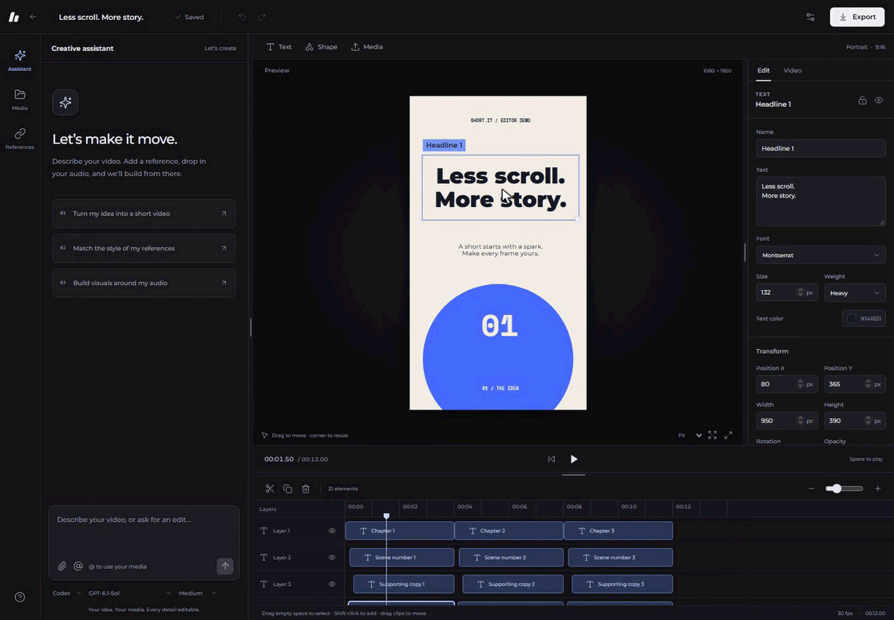
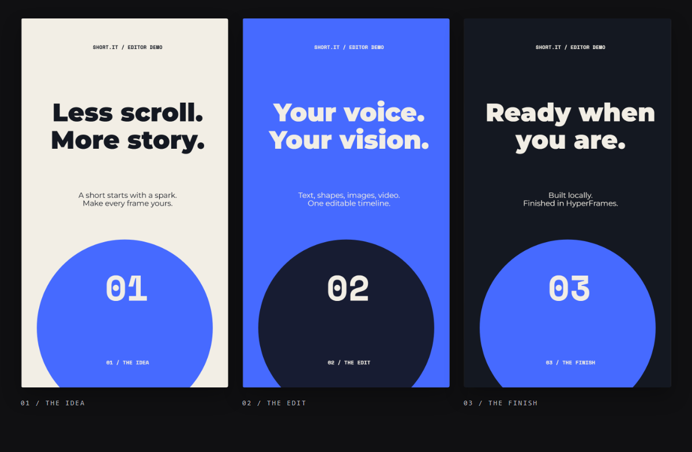
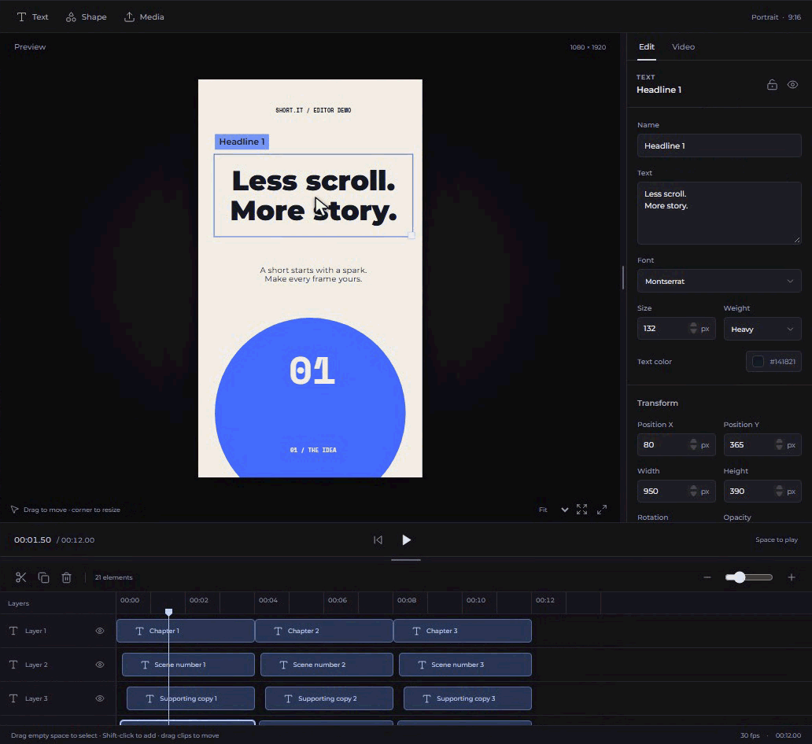
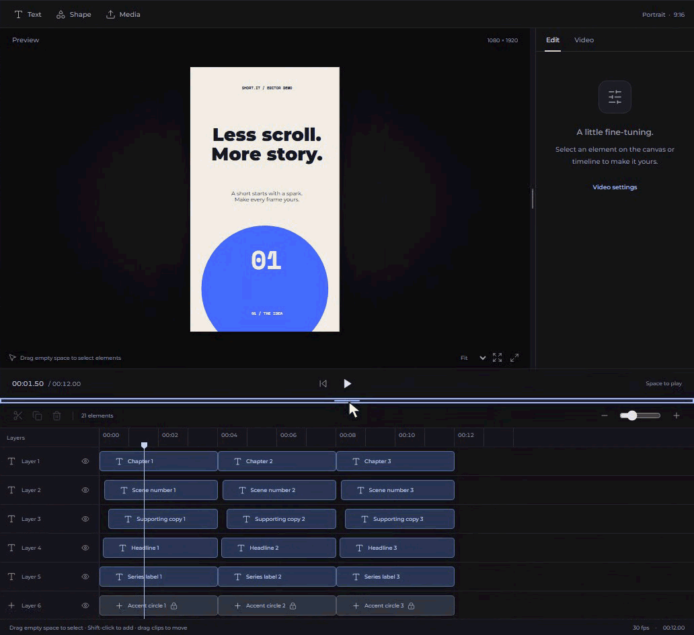
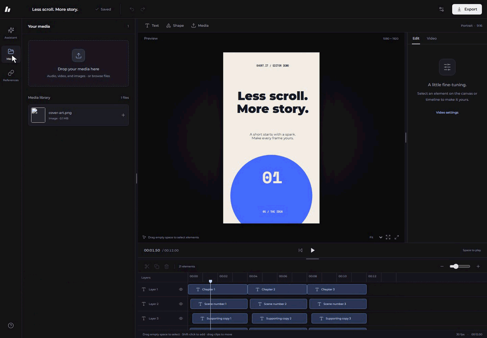
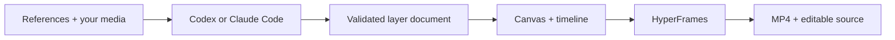

# short.it

<p align="center">
  <picture>
    <source media="(prefers-color-scheme: dark)" srcset="media/short-it-logo-dark.png">
    
  </picture>
</p>

> Your idea. Your references. A short you can keep editing.

short.it is a local workspace for making short-form videos with **Codex or Claude Code**. Bring references, narration and music, describe what you want, then refine the result on a canvas and timeline. **HyperFrames renders the finished MP4.** Your projects live on your machine; the agent uses its existing CLI login.

[](media/short-it-editor.gif)

<p align="center">
  <a href="#features">Features</a> ·
  <a href="#install">Install</a> ·
  <a href="#requirements">Requirements</a> ·
  <a href="#how-it-works">How it works</a> ·
  <a href="docs/README.md">Documentation</a>
</p>

Three scenes from the original documentation demo. Every headline, shape and clip stays editable:



[View a still image of the workspace](media/short-it-workspace.png). All GIFs show real editor interactions with this demo.

## Features

- **Your agent, in the workspace:** choose Codex or Claude Code, the model and the reasoning effort. Describe the video, attach your media and follow the agent's progress in chat. Each engine keeps its own conversation. Leaving a project or closing the tab keeps an active turn running; return to recover its progress while the server stays up.

- **A canvas for the final say:** select text or shapes, rewrite copy, change font, weight and color, drag to move, or pull the corner to resize. The Edit panel gives you exact position, size, rotation and opacity. Box-select several elements and move, duplicate or delete them together. Undo and redo work across your edits; layers can be hidden or locked.

  [](media/short-it-canvas.gif)

- **Timing you can put your hands on:** drag clips to move them, drag an edge to trim, and split at the playhead. Click or scrub the ruler to see another moment; zoom in for finer work. The inspector edits start time, duration and fades, plus source trim and volume for audio and video.

  [](media/short-it-timeline.gif)

- **Your media, in context:** import images, video, narration and music into a local library, then add them to the timeline. Type `@` in chat to mention an asset and attach it to your request. Tell the agent which audio is your voiceover and which is the music bed.

  [](media/short-it-media.gif)

- **A workspace that fits the edit:** resize the assistant, properties panel and timeline by dragging their dividers. Collapse the left panel for more room, or open a fullscreen preview. Choose portrait **9:16**, landscape **16:9** or square **1:1**, with 24, 25, 30 or 60 fps. Panel sizes are remembered in your browser.

  [](media/short-it-workspace.gif)

- **References the agent can inspect:** add up to five YouTube videos or Shorts, Instagram Reels/video posts, or TikTok videos. The local pipeline downloads the source, extracts every decoded frame and saves a real transcript from platform captions or local Whisper. Failed imports show an error and can be retried; platform access and download restrictions still apply.

- **MP4 and editable source:** export through HyperFrames. The project keeps its layer document, generated HTML composition and media alongside the finished video, so you can inspect the source or continue working in HyperFrames. The editor and compiler share the same layer model.

## Install

Requires **Node.js 22.18 or newer**.

```sh
git clone https://github.com/maurild14/short.it.git
cd short.it
npm install
npm run dev
```

Open [http://127.0.0.1:3210](http://127.0.0.1:3210). Install and sign in to Codex or Claude Code separately to use the chat. The editor can be used without an agent CLI.

Check your external tools with:

```sh
npm run doctor
```

For a production build:

```sh
npm run build
npm start
```

### Start from another folder

Build the app once, then run its launcher from the folder where you want your projects:

```sh
node /path/to/short.it/scripts/short-it.mjs
```

Visit the local address to open the UI. Projects are stored beneath the folder where you launched it. Add `--dev` for development, or run `npm link` in the repository to make the `short-it` command available locally.

To choose a project directory explicitly:

```sh
npm run dev -- --workspace /path/to/video-projects
```

## Requirements

| Tool | Used for |
| --- | --- |
| **Node.js 22.18+** | Running the application |
| **Codex CLI or Claude Code**, installed and signed in | Creating and editing through chat; uses your configured provider account |
| **FFmpeg and ffprobe** | Reference frames, media metadata and export validation |
| **yt-dlp** | Downloading supported reference videos |
| **faster-whisper or the Whisper CLI** | Local transcription when a reference has no usable platform captions |
| **HyperFrames** | MP4 rendering; the app uses a pinned npm CLI fallback when it is not installed locally |

The first transcription can download a Whisper model. The first export can download HyperFrames and its browser/runtime assets. See [media setup](docs/media.md) for installation commands, output files and troubleshooting.

## How it works



One Node process serves the React editor and local API. Chat starts your chosen CLI in the project's directory with the current document, assets and reference context. The agent edits `document.json`; the server validates the result before applying it to the editor. Export compiles that same document into a HyperFrames composition.

| Part | What it does |
| --- | --- |
| **React + TypeScript** | Canvas, timeline, properties, media library and chat |
| **Local Node server** | Project storage, uploads, agent streaming and background jobs |
| **Codex / Claude Code** | Agent tools, models and authentication through your installed CLI |
| **yt-dlp + FFmpeg + Whisper** | Reference downloads, full frame extraction and transcripts |
| **HyperFrames** | Compiling the editable document into a rendered video |

Projects are JSON files and media folders on disk. There is no database or short.it account to set up. See [architecture](docs/architecture.md), [agent integration](docs/agents.md) and the [editable video contract](docs/agent-contract.md).

## Current scope

The editor supports positioned **text, shapes, images, video and audio**, with layer timing, transforms, trims, volume and fades. It is an initial implementation, with a smaller effect set than a professional video editor. Effects outside the layer model need matching document, preview and compiler support; arbitrary generated HTML is not imported into the canvas. Reference-style fidelity depends on the agent, available media and supported effects.

Web search, image search and image generation depend on the selected CLI's tools, model and account. Codex ImageGen is not available in every CLI installation; Claude needs a configured image tool or skill. Missing capabilities and failed external tools remain visible in the app.

## Privacy and costs

- Project files, media, references and transcripts are stored locally and excluded from Git. The app listens on `127.0.0.1` and rejects cross-origin requests. Keep it local; it has no application login.
- Your agent CLI can send prompts, project context and attached media to its configured provider. Local project storage does not make the AI offline. CLI tools and integrations run with their own permissions; the app is a trusted-user tool, not a complete operating-system sandbox.
- Reference downloads contact their source platforms. Download availability varies; private posts and authentication challenges may fail. Every decoded reference frame is saved, so long or high-resolution references can take substantial disk space.
- short.it is MIT licensed. Agent, generation and rendering services may have their own pricing and terms under the accounts you use.

See [SECURITY.md](SECURITY.md) for the threat model and vulnerability reporting.

## Contributing

See [CONTRIBUTING.md](CONTRIBUTING.md). Start with [AGENTS.md](AGENTS.md) for the repository's engineering contracts, or browse the [documentation](docs/README.md).

```sh
npm test
npm run build
```

The browser checks are documented in [development](docs/development.md). The README recordings and their provenance are described in [media/README.md](media/README.md).

## License

[MIT](LICENSE)
